**Github Page:** [Barber Navalha](https://er1ckvictor.github.io/Barber-navalha/)
--
# Barber Navalha

Site de barbearia em uma página, com uma animação em three.js controlada pelo scroll: o poste de barbeiro gira, a câmera se aproxima até entrar numa listra e, a partir daí, cada seção é uma volta do poste.

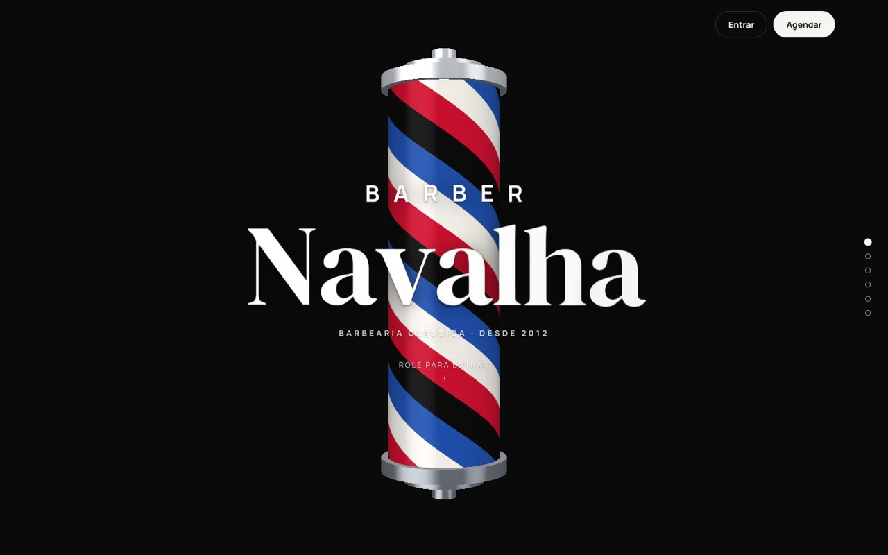

> **Projeto de exemplo.** Os dados são fictícios e não existe backend: login, agendamentos e comentários ficam salvos no `localStorage` do navegador.

## Funcionalidades

- Abertura animada que avança e volta junto com o scroll
- Navegação seção por seção (roda do mouse, trackpad, toque, teclado, bolinhas laterais e links `#id`)
- Barbeiros com foto, descrição e avaliação
- Agendamento em etapas: dia e horário, serviço (com busca e categorias) e resumo com observação e forma de pagamento
- Lista de serviços que leva direto para o agendamento
- Planos mensais, horário de funcionamento (com "aberto agora") e comentários
- Login com telefone e senha, menu da conta e página de perfil (editar nome, trocar senha, excluir conta)
- Acompanhamento dos agendamentos: marcado, confirmado, concluído e cancelado
- Layout responsivo e suporte a `prefers-reduced-motion`

## Tecnologias

- [Next.js](https://nextjs.org/) (App Router) e React
- TypeScript
- [three.js](https://threejs.org/) com shaders próprios
- CSS puro
- Fontes locais com [@fontsource](https://fontsource.org/) (DM Serif Display e Manrope)

## Rodando localmente

Precisa do Node.js 20.9 ou mais novo (tem um `.nvmrc` na raiz).

```bash
git clone <url-do-repositorio>
cd barbearia
npm install
npm run dev
```

Depois é só abrir http://localhost:3000.

### Scripts

| Comando | O que faz |
| --- | --- |
| `npm run dev` | servidor de desenvolvimento |
| `npm run build` | gera o site estático em `out/` |
| `npm start` | serve a pasta `out/` gerada pelo build |
| `npm run typecheck` | checagem de tipos com o `tsc` |

## Publicando no GitHub Pages

O projeto já sai como site estático (`output: 'export'`) e tem um workflow em [`.github/workflows/deploy.yml`](.github/workflows/deploy.yml).

1. Suba o repositório para o GitHub.
2. Em **Settings → Pages**, escolha **GitHub Actions** como fonte.
3. Faça um push na `main` (ou rode o workflow manualmente em **Actions**).

O workflow descobre sozinho o caminho do site (`/<nome-do-repo>`) e passa para o build em `NEXT_PUBLIC_BASE_PATH`. Para testar localmente com o mesmo caminho:

```bash
NEXT_PUBLIC_BASE_PATH=/barbearia npm run build
```

## Estrutura

```
src/
├── app/
│   ├── page.tsx              # home
│   ├── conta/                # /conta/perfil e /conta/agendamentos
│   ├── globals.css
│   └── sections.css
├── components/
│   ├── BarberSite.tsx        # monta a home e liga o engine da animação
│   ├── booking/              # modal de agendamento
│   ├── account/              # menu, perfil e lista de agendamentos
│   └── auth/                 # modal de login
├── data/barbearia.ts         # todo o conteúdo do site
├── hooks/useLocalData.ts     # leitura reativa do localStorage
├── lib/
│   ├── animation/            # engine (three.js) e shaders
│   ├── auth.ts               # login fake
│   ├── booking.ts            # dias, horários e agendamentos
│   └── comentarios.ts
└── types/barbearia.ts
```

## Personalizando

**Conteúdo.** Textos, serviços, preços, barbeiros, planos, horários e comentários ficam em [`src/data/barbearia.ts`](src/data/barbearia.ts).

**Fotos.** As fotos vêm direto do CDN do Unsplash, com corte e tamanho definidos na própria URL (função `unsplash()` no arquivo de dados). Para usar outra, troque o id da foto. Para usar fotos próprias, coloque em `public/img/` e lembre que no GitHub Pages o caminho precisa do prefixo do repositório (ex: `${process.env.NEXT_PUBLIC_BASE_PATH}/img/rafael.jpg`).

**Cores do poste.** Ficam em `COLORS`, no [`shaders.ts`](src/lib/animation/shaders.ts).

**Velocidade da animação.** O objeto `TIMING` no [`BarberPoleEngine.ts`](src/lib/animation/BarberPoleEngine.ts) controla a duração da abertura e o ritmo entre seções.

## Como a animação funciona

O engine roda fora do React, num loop próprio, e só avisa o React quando a seção muda. Assim não tem re-render a cada frame.

1. O scroll não move a página. Cada gesto vira um pedido de "próxima seção" ou "seção anterior", e gestos durante a animação são ignorados.
2. Na abertura, o poste gira e se aproxima. O giro é ajustado para terminar com o meio de uma listra preta no centro da tela, e aí o zoom encosta nela.
3. Depois disso, a tela vira um shader de tela cheia que imita a superfície do poste de perto. Cada seção gira meio ciclo das listras, então o fundo alterna entre preto e branco, com o vermelho e o azul passando na transição.
4. Seções com conteúdo maior (listas no celular, horários e comentários) têm scroll próprio. A troca de seção só acontece quando esse scroll chega no fim.

Sem WebGL, o site vira uma página comum com scroll normal.

## Limitações

Como tudo roda no navegador:

- O login não tem segurança real. A senha é guardada com um hash simples (FNV-1a), só para não ficar em texto puro.
- Os horários ocupados são simulados.
- A confirmação da barbearia também é simulada: o agendamento vira "confirmado" depois de alguns segundos.
- Cada navegador tem seus próprios dados.

Para usar de verdade, o caminho é trocar [`src/lib/auth.ts`](src/lib/auth.ts), [`src/lib/booking.ts`](src/lib/booking.ts) e [`src/lib/comentarios.ts`](src/lib/comentarios.ts) por chamadas a uma API.

## Screenshots

| Main | Barbeiros |
| --- | --- |
| 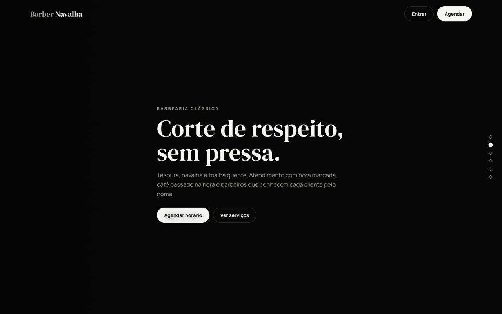 | 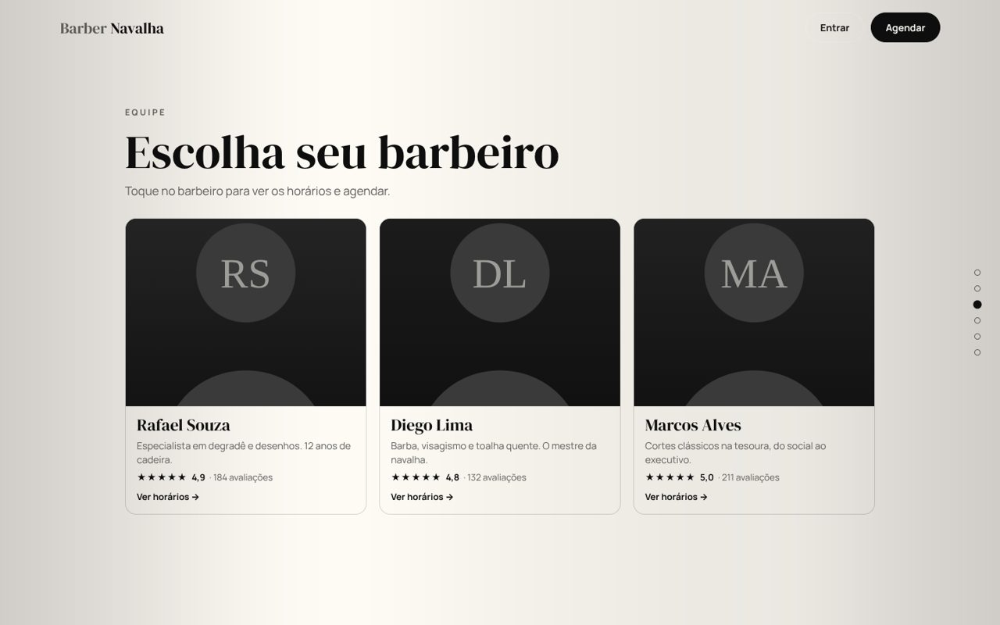 |
| **Serviços** | **Planos** |
| 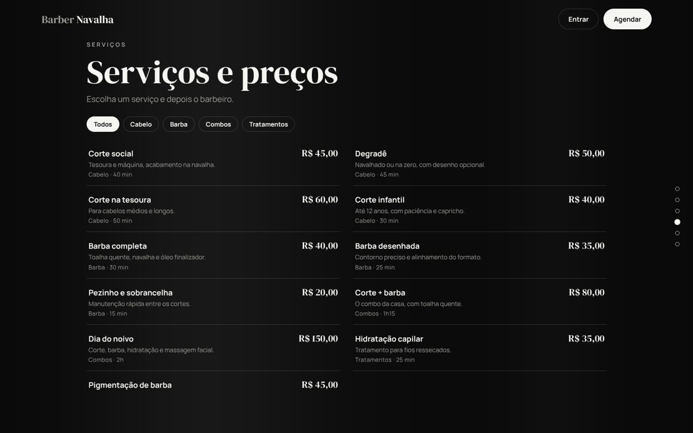 | 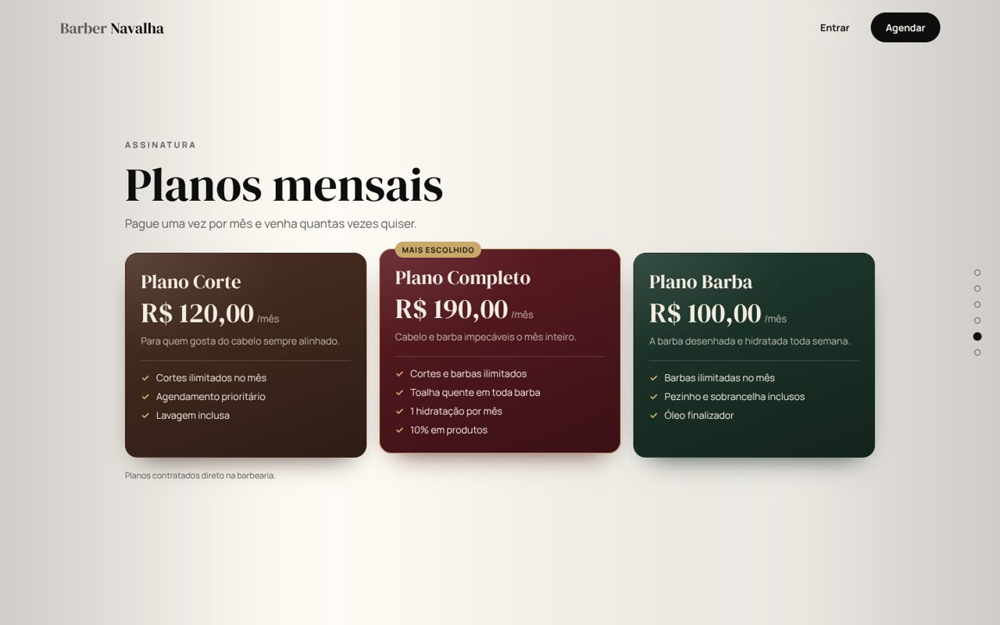 |
| **Horários e comentários** | **Agendamento** |
| 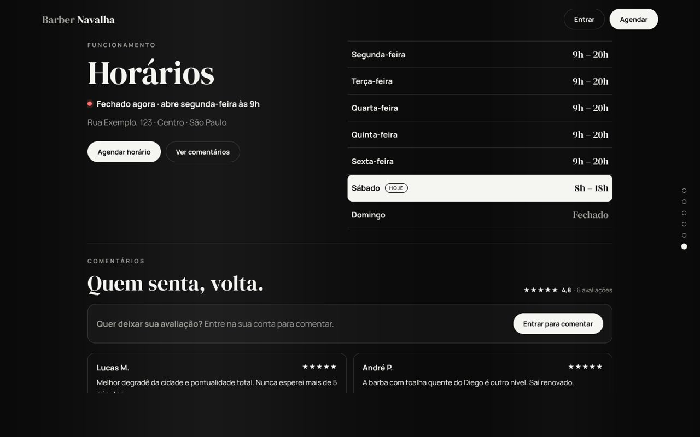 | 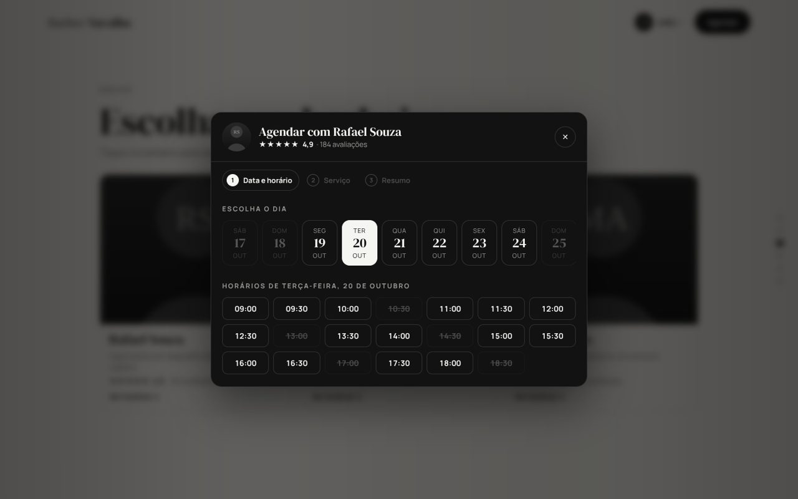 |
| **Minha conta** | |
| 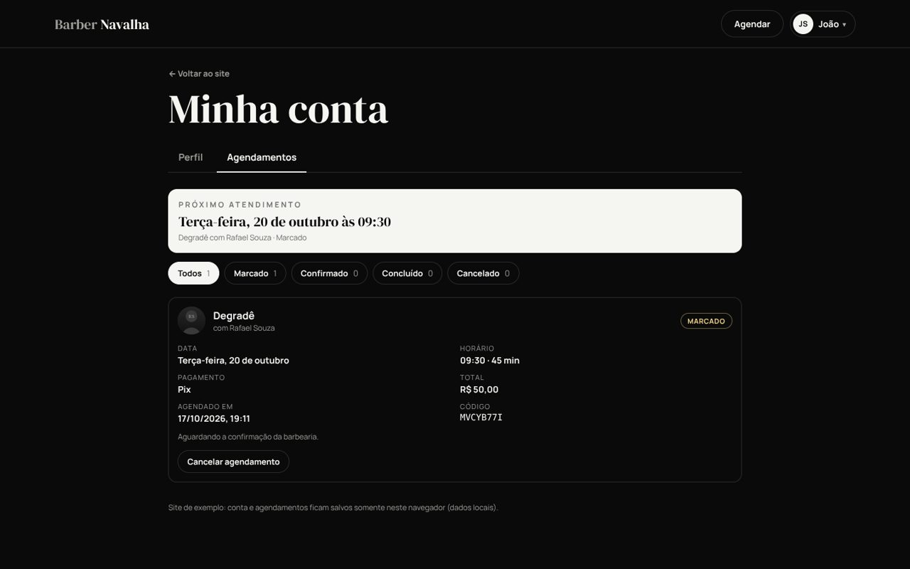 | |

<p align="center">
  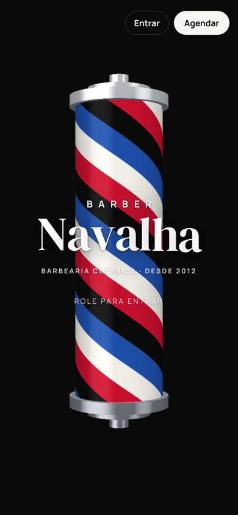
  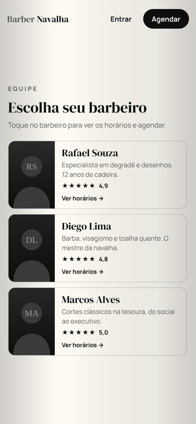
  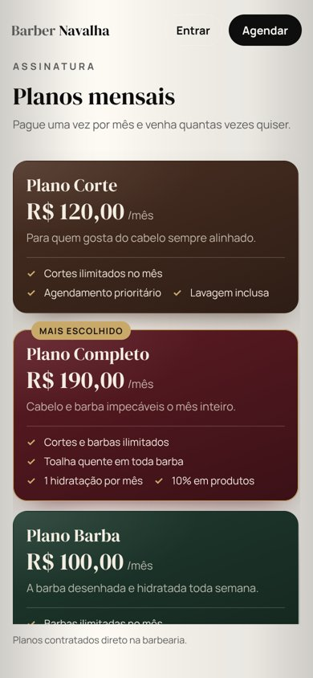
</p>

## Créditos

Fotos do [Unsplash](https://unsplash.com/license), todas com a licença livre (uso comercial permitido, sem atribuição obrigatória):

- Main: [Joshua Lawrence](https://unsplash.com/photos/black-and-silver-barber-chair-dU6eE_j2My8)
- Rafael: [Allef Vinicius](https://unsplash.com/photos/man-sitting-on-barbers-chair-IvQeAVeJULw)
- Diego: [Blanche Peulot](https://unsplash.com/photos/a-man-with-a-beard-is-posing-for-a-picture-f0T1OTh_q4o)
- Marcos: [Eugene Chystiakov](https://unsplash.com/photos/shallow-focus-photo-of-man-holding-scissors-taZSJ6xmt48)
